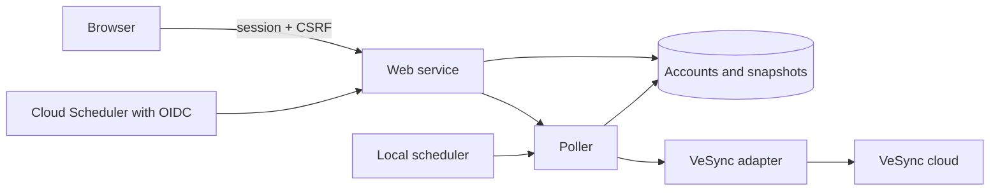

# Service foundation

## Structure

The FastAPI service serves the compiled React application and JSON endpoints from one origin. SQLAlchemy supports SQLite locally and PostgreSQL on Cloud Run. Alembic owns schema changes.

The provider adapter returns normalized purifier snapshots and classified failures. The poller owns scheduling, persistent leases, cooldowns, credentials, and snapshot updates. UI reads use the database only.

## Interfaces

| Route | Purpose | Authentication |
| --- | --- | --- |
| `GET /api/session` | Login methods, current identity, CSRF token | Optional session |
| `POST /api/login` | Local administrator login | Password, throttled |
| `POST /api/logout` | Revoke the current session | Session + CSRF |
| `GET /auth/google/login` | Start Google sign-in | Browser flow |
| `GET /auth/google/callback` | Consume the Google authorization flow | State, browser cookie, verified identity |
| `GET /api/accounts` | Account connection status and refresh deadlines | Session |
| `GET /api/devices/{id}/history?hours=24` | Recorded air-quality history for 24 hours, 7 days, or 30 days | Session |
| `POST /api/devices/{id}/control` | Set power, mode, or manual fan level | Session + CSRF |
| `POST /api/devices/{id}/status` | Read one device's current provider status | Session + CSRF |
| `POST /api/accounts` | Save credentials and attempt initial discovery | Session + CSRF |
| `PUT /api/accounts/{id}` | Replace credentials and reconnect | Session + CSRF |
| `DELETE /api/accounts/{id}` | Delete credentials and associated snapshots | Session + CSRF |
| `GET /api/devices` | Cached purifier snapshots | Session |
| `POST /api/accounts/{id}/refresh` | Attempt a refresh using the shared cooldown | Session + CSRF |
| `POST /internal/poll` | Refresh all due accounts | Verified scheduler OIDC token |
| `GET /health/live` | Process health | Public |
| `GET /health/ready` | Database/schema readiness | Public |

Account writes require `provider` (currently only `vesync`), `label`, and the provider's connection fields: `email`, `password`, `country_code`, and `time_zone` for VeSync. The selected provider is stored on the account and returned in account responses. Migration `0002` backfills existing accounts as VeSync. Another adapter will require provider dispatch and its own connection validation. A reconnect keeps the existing provider and email; connect another account to change identity. Invalid provider credentials leave a saved account marked `auth_error`, so they can be corrected in the UI.

The UI's `accounts/ConnectionForm.tsx` owns provider selection and the shared account label. `accounts/providers` registers each provider's fields and request serialization. Add a provider module and extend the account type union when another backend adapter is available. Provider-specific fields stay out of the application shell.

Device responses include internal IDs, account label, name, model, support status, capabilities, controls, state, retrieval time, staleness, and errors. `controls` lists supported power, modes, and fan levels; `control_available` and `control_retry_at` describe command availability and cooldown. State includes connectivity, power, mode, fan level, available PM readings, qualitative air quality, and filter life. Unsupported measurements are omitted from capabilities and have null values. Retrieval timestamps describe when the app fetched data, not when the sensor measured it.

A refresh returns `429` with `retry_after` and a `Retry-After` header during cooldown. `401` requests sign-in, `403` rejects request verification, `409` indicates a duplicate account, an active refresh, or credentials requiring attention, and `422` indicates invalid configuration. Password inputs are removed from validation error responses.

## Persistence and failure handling

Account refresh claims use an atomic database update, a five-minute lease, and a unique worker token. Polls have a four-minute timeout. Only the current lease holder may persist results. Credential updates respect refresh claims and existing cooldowns; deletion invalidates any pending result. Purifier IDs are scoped to their connected account.

Successful discovery removes devices that have disappeared. Incomplete polls retain existing snapshots and may save successfully retrieved devices. Offline devices retain previous sensor readings with an offline marker. Provider errors expose fixed messages rather than raw upstream responses.

The VeSync adapter uses `pyvesync` 3.4.2 through the lockfile. It intercepts expired-token responses before the library retries with the previous request body, reauthenticates once, and rebuilds the request. Tests exercise the installed library's purifier models and this response classification.

Logs record poll outcomes and stable failure events with internal account IDs. Access logs and vendor debug logs are disabled to keep authentication codes, emails, passwords, and tokens out of logs. Use readiness checks, account errors, retrieval ages, and Cloud Scheduler execution results to monitor operation.

## Device controls

Each supported purifier card has a power switch and a single fan selector: Auto and Sleep when supported, followed by that model's numbered levels. Selecting a level sets manual mode. Mode and speed controls are disabled while the purifier is off or offline; commands require a session and CSRF verification.

Controls update optimistically. Only the card being changed is disabled during its request and cooldown. Commands use the same account lease and request pacing as polling; requests wait up to 30 seconds for a busy account or the five-second command spacing. Waiting requests hold no lease or worker slot. Provider rate-limit backoff returns immediately. A command discovers and reads only its target, sends the change, then reads status once immediately. The response returns observed state and `control_confirmed`; an unconfirmed setting stays selected for up to 90 seconds while normal polls reconcile delayed readings, then the latest observed setting is shown. New polls do not extend this window. Status reads and command readbacks validate parsed details before saving a fresh timestamp; malformed responses preserve cached readings. Manual fan selection uses the configured speed when available; `reported_fan_level` retains the running speed. Older cached responses cannot replace newer readings. Other purifier snapshots are retained. Commands have a five-second cooldown measured from the start; status reads and normal polls do not extend it. Provider rate-limit backoff still applies to all requests. Rejected commands revert the optimistic setting and show an error. Migration `0004` adds supported-control metadata and the shared cooldown; existing devices receive their controls on the next poll.

## Air-quality history

The installed pyvesync library exposes current purifier readings, not the VeSync app's historical series. The app records fresh, online readings from existing polls and confirmed control readbacks in `device_readings`; history adds no VeSync requests. PM2.5, PM1, PM10, and qualitative air quality are stored when available. Failed, offline, repeated, and invalid readings do not create samples. History begins with the first successful poll after migration `0003` and survives restarts.

The history endpoint reads the database only, accepts `hours=24`, `168`, or `720`, and returns approximately 360 time buckets per metric. PM buckets include the average, minimum, maximum, and sample count; qualitative buckets show the worst reported level. Missing buckets remain empty and charts leave gaps. The UI charts PM2.5, colored by the recorded air-quality category (gray when unavailable). History sections start collapsed. When expanded, the heading shows 24h, 7d, and 30d buttons; charts update automatically and show the date/time and PM2.5 value inside the chart on hover. Records older than 30 days are pruned during polling; removing an account or device also removes its history.
