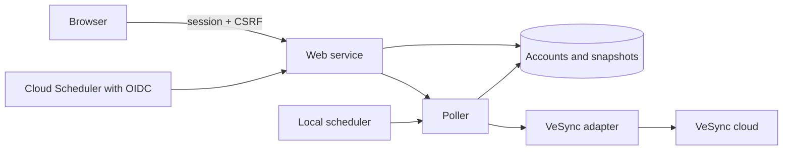

# Service foundation

## Structure

The FastAPI service serves the compiled React application and JSON endpoints from one origin. SQLAlchemy supports SQLite locally and PostgreSQL on Cloud Run. Alembic owns schema changes.

The provider adapter returns normalized purifier snapshots and classified failures. The poller owns scheduling, persistent leases, cooldowns, credentials, and snapshot updates. UI reads use the database only.

## Interfaces

| Route | Purpose | Authentication |
| --- | --- | --- |
| `GET /api/session` | Login methods, current identity, CSRF token | Optional session |
| `POST /api/login` | Local administrator login | Password, throttled |
| `POST /api/logout` | Revoke the current session | Session + CSRF |
| `GET /auth/google/login` | Start Google sign-in | Browser flow |
| `GET /auth/google/callback` | Consume the Google authorization flow | State, browser cookie, verified identity |
| `GET /api/accounts` | Account connection status and refresh deadlines | Session |
| `GET /api/devices/{id}/history?hours=24` | Recorded air quality with purifier setting bands; `raw=true` returns paired observations for rule planning | Session |
| `GET /api/outdoor` | Cached outdoor station, AQI readings, freshness, errors, and backfill status | Session |
| `GET /api/outdoor/history?hours=24` | Overall and pollutant AQI history for 24 hours, 7 days, or 30 days | Session |
| `POST /api/outdoor/stations/search` | Search AQICN stations by city or station name | Session + CSRF |
| `POST /api/outdoor/stations/nearby` | Find the AQICN station for browser geolocation | Session + CSRF |
| `PUT /api/outdoor/location` | Select a station from the latest search results | Session + CSRF |
| `DELETE /api/outdoor/location` | Clear the saved location and stop collection | Session + CSRF |
| `POST /api/devices/{id}/control` | Set power, mode, or manual fan level | Session + CSRF |
| `POST /api/devices/{id}/status` | Read one device's current provider status | Session + CSRF |
| `POST /api/accounts` | Save credentials and attempt initial discovery | Session + CSRF |
| `PUT /api/accounts/{id}` | Replace credentials and reconnect | Session + CSRF |
| `DELETE /api/accounts/{id}` | Delete credentials and associated snapshots | Session + CSRF |
| `GET /api/devices` | Cached purifier snapshots | Session |
| `POST /api/accounts/{id}/refresh` | Attempt a refresh using the shared cooldown | Session + CSRF |
| `/api/devices/{id}/automation/*` | Rule editing/preview, ownership, pauses, decision history, and agent planning | Session; writes also require CSRF |
| `POST /internal/poll` | Refresh due accounts, collect outdoor data, and evaluate rules | Verified scheduler OIDC token |
| `GET /health/live` | Process health | Public |
| `GET /health/ready` | Database/schema readiness | Public |

Account writes require `provider` (currently only `vesync`), `label`, and the provider's connection fields: `email`, `password`, `country_code`, and `time_zone` for VeSync. The selected provider is stored on the account and returned in account responses. Migration `0002` backfills existing accounts as VeSync. Another adapter will require provider dispatch and its own connection validation. A reconnect keeps the existing provider and email; connect another account to change identity. Invalid provider credentials leave a saved account marked `auth_error`, so they can be corrected in the UI.

The UI's `accounts/ConnectionForm.tsx` owns provider selection and the shared account label. `accounts/providers` registers each provider's fields and request serialization. Add a provider module and extend the account type union when another backend adapter is available. Provider-specific fields stay out of the application shell.

Device responses include internal IDs, account label, name, model, support status, capabilities, controls, state, retrieval time, staleness, and errors. `controls` lists supported power, modes, and fan levels; `control_available` and `control_retry_at` describe command availability and cooldown. State includes connectivity, power, mode, fan level, available PM readings, qualitative air quality, and filter life. Unsupported measurements are omitted from capabilities and have null values. Retrieval timestamps describe when the app fetched data, not when the sensor measured it.

A refresh returns `429` with `retry_after` and a `Retry-After` header during cooldown. `401` requests sign-in, `403` rejects request verification, `409` indicates a duplicate account, an active refresh, or credentials requiring attention, and `422` indicates invalid configuration. Password inputs are removed from validation error responses.

## Persistence and failure handling

Account refresh claims use an atomic database update, a five-minute lease, and a unique worker token. Polls have a four-minute timeout. Only the current lease holder may persist results. Credential updates respect refresh claims and existing cooldowns; deletion invalidates any pending result. Purifier IDs are scoped to their connected account.

Successful discovery removes devices that have disappeared. Incomplete polls retain existing snapshots and may save successfully retrieved devices. Offline devices retain previous sensor readings with an offline marker. Provider errors expose fixed messages rather than raw upstream responses.

The VeSync adapter uses `pyvesync` 3.4.2 through the lockfile. It intercepts expired-token responses before the library retries with the previous request body, reauthenticates once, and rebuilds the request. Tests exercise the installed library's purifier models and this response classification.

Logs record poll outcomes and stable failure events with internal account IDs. Access logs and vendor debug logs are disabled to keep authentication codes, emails, passwords, and tokens out of logs. Use readiness checks, account errors, retrieval ages, and Cloud Scheduler execution results to monitor operation.

## Device controls

Each supported purifier card has a power switch and a single fan selector: Auto and Sleep when supported, followed by that model's numbered levels. Selecting a level sets manual mode. Mode and speed controls are disabled while the purifier is off or offline; commands require a session and CSRF verification.

Controls update optimistically. Only the card being changed is disabled during its request and cooldown. Commands use the same account lease and request pacing as polling; requests wait up to 30 seconds for a busy account or the five-second command spacing. Waiting requests hold no lease or worker slot. Provider rate-limit backoff returns immediately. A command discovers and reads only its target, sends the change, then reads status once immediately. The response returns observed state and `control_confirmed`; an unconfirmed setting stays selected for up to 90 seconds while normal polls reconcile delayed readings, then the latest observed setting is shown. New polls do not extend this window. Status reads and command readbacks validate parsed details before saving a fresh timestamp; malformed responses preserve cached readings. Manual fan selection uses the configured speed when available; `reported_fan_level` retains the running speed. Older cached responses cannot replace newer readings. Other purifier snapshots are retained. Commands have a five-second cooldown measured from the start; status reads and normal polls do not extend it. Provider rate-limit backoff still applies to all requests. Rejected commands revert the optimistic setting and show an error. Migration `0004` adds supported-control metadata and the shared cooldown; existing devices receive their controls on the next poll.

## Air-quality history

Indoor history is independent of the outdoor station described below.

The installed pyvesync library exposes current purifier readings, not the VeSync app's historical series. The app records fresh, online observations from existing polls and valid status/control readbacks in `device_readings`; history adds no VeSync requests. PM2.5, PM1, PM10, and qualitative air quality are stored when available. Migration `0008` adds observed power, mode, selected fan level, and reported running fan level to the same timestamped rows. These settings are recorded even without sensor measurements or while power is off. Unsupported or invalid fields remain null; failed, offline, errored, repeated, and older observations create no samples. An unconfirmed command records only valid observed state, never the requested optimistic override. Air-quality history starts after migration `0003`; settings start after `0008`, with existing readings preserved and their settings left unknown. History survives restarts.

The history endpoint reads the database only, accepts `hours=24`, `168`, or `720`, and returns approximately 360 time buckets per metric. PM buckets include the average, minimum, maximum, and sample count; qualitative buckets show the worst reported level. Its `settings` array keeps exact observed transitions instead of averaging fan levels or losing brief changes inside a metric bucket. Consecutive identical settings are merged only when observations are within the freshness window (three polling intervals, at least 180 seconds). Bands run from `recorded_at` to `end_at`, stop at the final observation, and leave unknown periods empty; singleton observations show a marker. Missing metric buckets also remain empty.

The UI charts PM2.5, colored by the recorded air-quality category (gray when unavailable), with shaded setting bands, a matching setting strip, and a dashed fan-speed step line on the same time axis. Fan speed uses the right axis: selected speed in manual mode, reported running speed in other modes (selected speed when running speed is unavailable), and zero while off. Sections are captioned **History** and start collapsed. Expanding a section shows 24h, 7d, and 30d buttons; charts update automatically. Hover or touch shows the bucket date/time and PM2.5 value, plus the observed setting at the inspected time (or `Setting unavailable` in a gap), in reserved space above the plot. Native chart tooltips are omitted; ARIA labels provide chart and setting descriptions. Touch selections stay visible after the finger is lifted; mouse selections clear when the pointer leaves the chart. Sensorless purifiers can display setting history alone. Outdoor charts remain separate; if the selected metric is unavailable, their history shows an unavailable message without requesting history or showing a history loader. Fetching begins when that metric becomes available.

`raw=true` returns an `observations` array with exact retrieval timestamps, all four measurement fields, and all four setting fields from each row, without bucketing or merging. Qualitative air quality uses ranks 1 (excellent/very good), 2 (good), 3 (moderate), and 4 (poor/bad). This preserves paired inputs for agent rule planning; retrieval times are not sensor measurement or command execution times. `limit` is 1–5000 (default 1000); a non-null `next_after` is the last returned timestamp and must be passed as `after` for the next page. Null means there are no more matching observations. Records older than 30 days are pruned during polling; removing an account or device also removes its history. Deterministic rules and the planning interface are described in [device automation](AUTOMATION.md); model invocation remains planned.

## Outdoor air quality

AQICN / WAQI is the outdoor source. `AQICN_API_TOKEN` enables access; users select their shared household station in the app. The application no longer uses OpenAQ or Open-Meteo. Overall `aqi` and individual `pm25`/`pm10` values are AQI, not concentrations. Indoor concentrations and outdoor indices remain separate. Device rules may explicitly reference cached outdoor readings as `aqi`, `pm25_aqi`, or `pm10_aqi`, with missing-data behavior defined by the ruleset.

`POST /api/outdoor/stations/search` accepts a trimmed `query` (2–120 characters), calls AQICN's `v2/search/` endpoint, and returns up to 20 matching stations with names, numeric AQI, update times, and any available coordinates. Results without valid AQI, duplicate IDs, and stations last updated more than seven calendar days ago are excluded. `POST /api/outdoor/stations/nearby` accepts strict bounded numeric latitude/longitude and uses AQICN's geolocation feed to return the local station. There is no geocoding service. Both actions require session and CSRF, share the collector's durable lease/pacing/backoff, and leave the selected station unchanged.

`PUT /api/outdoor/location` selects a positive `location_id` from the latest successful search, persists its coordinates where available, revokes pending workers, and makes that station due. The response includes the search AQI as a separate `preview` and `loading: true`, then a response background task invokes the collector immediately, respecting the existing leases, pacing, and backoff. The preview and pending flag persist in station metadata across reloads. A valid full feed replaces the preview; a failed read stops the loader and retains the preview and any prior cached measurements. Search AQI never creates observations or fabricates measurement timestamps. `DELETE /api/outdoor/location` stops collection. These writes require session and CSRF. Each provider token stays backend-only; request URLs, tokens, queries, and coordinates are not logged.

`GET /api/outdoor` reads cached data only. It returns source `aqicn`, source availability, saved selection, coordinates, station name/link/attributions, metric capabilities and values with unit `AQI`, source measurement times, staleness, retrieval time, and fixed safe errors. Its backfill status is `unsupported`. AQICN's `time.iso`, or local `time.s` with explicit `time.tz`, supplies the measurement timestamp. Malformed feeds and mismatched station IDs cannot replace cached values or timestamps. Missing pollutant values retain the prior valid reading with its original age. The browser refreshes this cache every 15 seconds while visible, or every second while a saved selection is loading. Pending cache requests are canceled when selection changes, and stale responses cannot overwrite a newer selection.

Collection runs through the existing local scheduler or `/internal/poll`, independent of device accounts. A tick claims a 120-second tokenized lease, makes one AQICN station-feed request when due, and times out after 90 seconds. Requests start at least two seconds apart across workers; provider backoff is shared with searches and preserved across station changes, including failures returned after a request loses its lease. Obsolete workers may extend shared cooldowns but cannot replace station readings or search results, release another worker’s lease, or shorten an existing cooldown. Each station polls every five minutes by default. Invalid-token errors suspend collection until the token or station changes. Other failures retry with bounded exponential backoff; rate limits respect `Retry-After`. Scheduler JSON includes `outdoor_checked`.

Migration `0007` creates `aqicn_stations` and `aqicn_readings` and clears the former OpenAQ selection/discovery/deadlines. Migrations `0005`/`0006` remain in the schema chain. Legacy OpenAQ tables retain concentrations separately; provider IDs may overlap without mixing histories. AQICN observations are unique by station + metric + measurement timestamp, with corrections upserted and older observations unable to replace newer current values. Active and legacy readings expire after 30 days during scheduled pruning, even without a selected station.

`GET /api/outdoor/history?hours=24|168|720` returns database-only bucketed mean/min/max/count series for overall AQI and the two pollutant AQIs. Charts use AQI units and refresh every minute while expanded. The public AQICN station-feed API does not provide a documented historical endpoint: no automatic station backfill is attempted. Forecasts and city-wide historical aggregates are not observations of the selected station. AQICN and originating agency attributions are preserved in the UI.

Outdoor and device cards share header and reading components. Outdoor agency/source attribution appears below the station name. Each outdoor value shows its measurement age inline; device readings show their retrieval age beside the unit, separated by a middot. History starts collapsed, with the outdoor metric selector beside the period controls inside the expanded section. The station card's **…** menu contains **Change location** and **Remove location**. Editing hides the current station card until saving succeeds or the user cancels; canceling preserves the saved selection.

### Browser location

**Use my location** invokes `navigator.geolocation.getCurrentPosition` and awaits its success/error callback before requesting `/api/outdoor/stations/nearby`. The options are `enableHighAccuracy: true`, `maximumAge: 300000`, and `timeout: 30000`. High accuracy is required on desktop systems (such as macOS) that lack GPS and cellular hardware so the browser triggers Wi-Fi network positioning via CoreLocation rather than timing out on unavailable coarse location. HTTPS or localhost and browser/device location access are required. The form displays a loader while waiting, distinguishes denied permission, unavailable positioning, and timeout, and preserves separate AQICN request errors. Errors appear in the form; they are caught rather than thrown to the console. City search does not depend on browser geolocation. Automated browser tests cover delayed positioning, positioning failures, and AQICN errors using mocked locations/providers.
